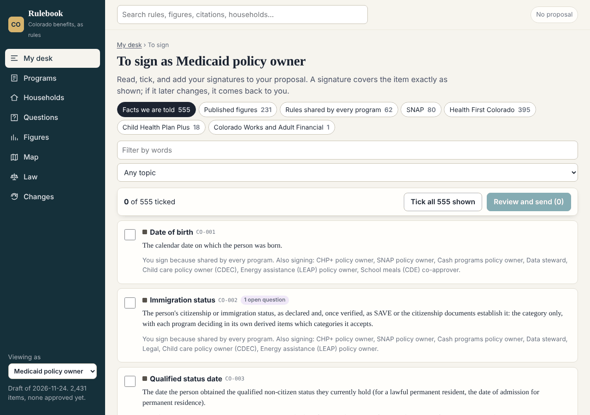
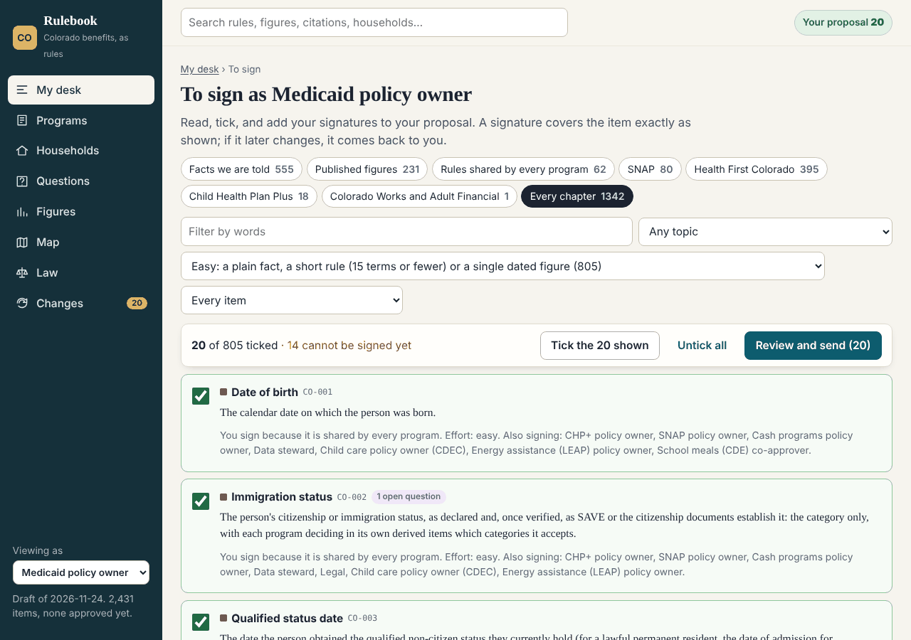
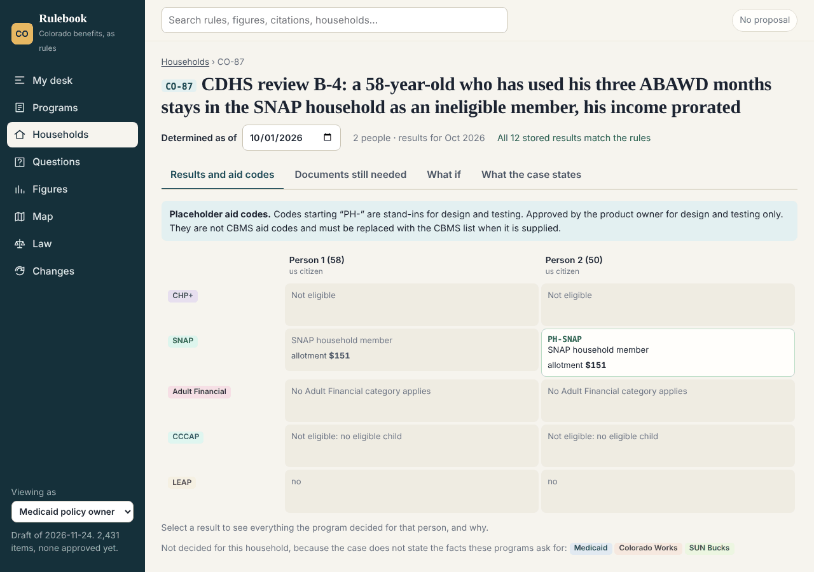
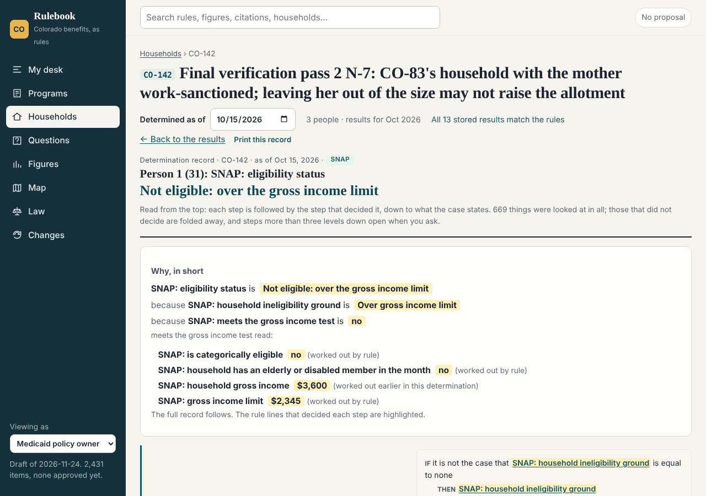
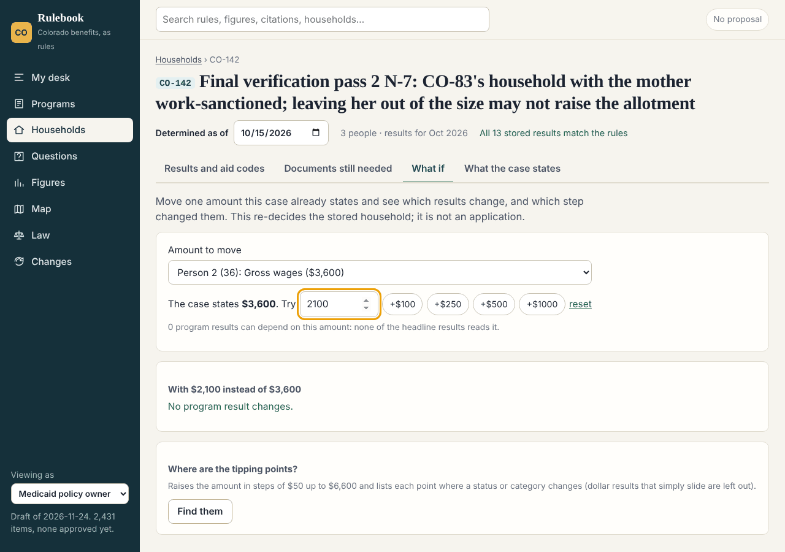
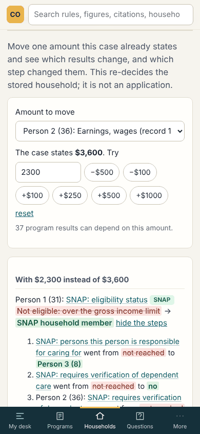
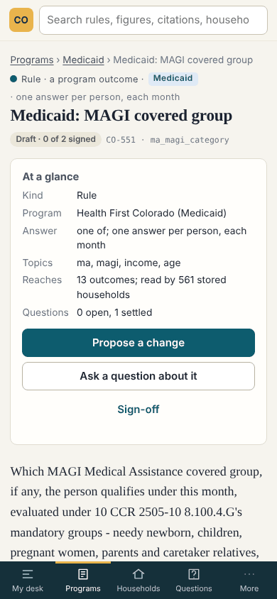
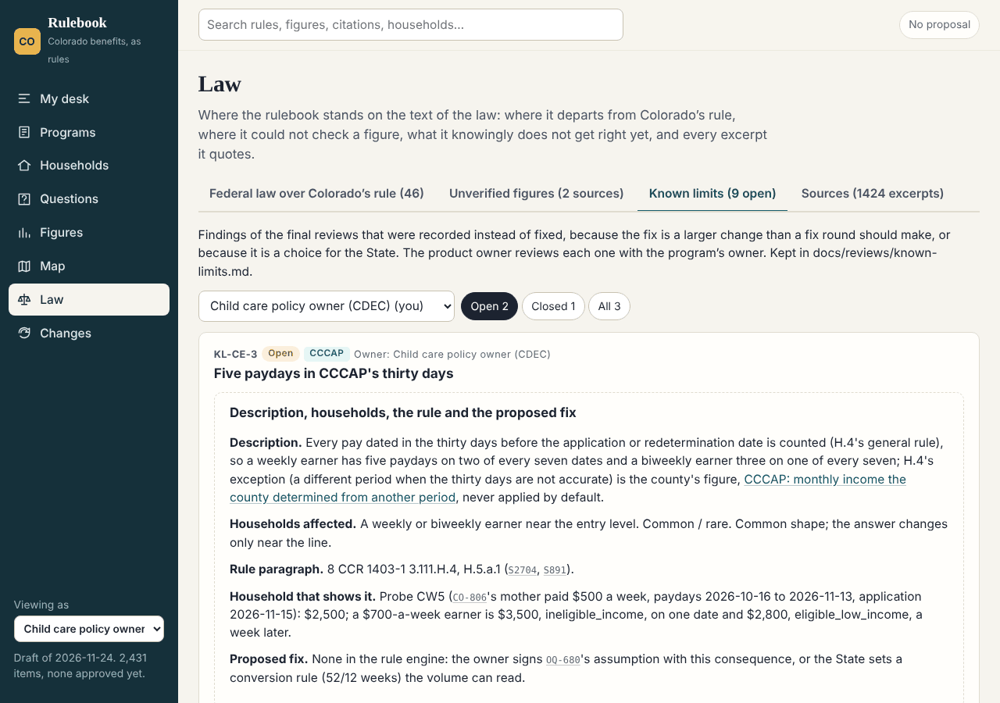

# Colorado Rulebook: persona usability check

Date: 2026-11-24. Prototype: prototypes/blind-b (the product owner's chosen UI, docs/handoff-2026-11-24.md section 7), from branch ccr-9d19bf4c-wmnwcl at 8e32fc4.

## Method

- Built with `npm run build:blind-b` (2,431 items, 416 questions, 561 stored households, 220 documents) and served `.artifacts/blind-b/` over a local HTTP server.
- Walked each task with Playwright and Chromium at 1280 and 390 wide. Each run recorded the steps, page errors, console errors and warnings, failed requests, horizontal page overflow, keyboard focus order and focus rings, and controls with no accessible name. Text contrast was computed from the stylesheet's colours.
- Ran the same walks inside a wrapper page: an outer html/body with the built index.html content placed inside the body, as the artifact host does.
- The personas follow docs/design-unified-ui.md and docs/design-onboarding.md (Dana, Marcus, Priya, Rosa, and the roles in src/ui/personas.ts), mapped onto the six roles named for this check. "Viewing as" was set to the matching approval role: Medicaid policy owner, Legal, Data steward, SNAP policy owner and Child care policy owner (CDEC). The analyst and the product owner used the default role.
- Severity: **P1** blocks the task, **P2** makes it slow or confusing, **P3** is polish.

Results everywhere: **no page errors, no console errors or warnings, no failed requests**, at either width, standalone or in the wrapper. The wrapper renders the same as the standalone page, because the app renders into `#app` and its stylesheet and script still load from inside the body. Before the fixes, only the determination record scrolled sideways at 390 (420 px wide). After the fixes, no page does.

Screenshots are in [rulebook-persona-check/](rulebook-persona-check/) (PNG, scale 1, 96 colours).

| Before | After |
|---|---|
|  "Tick all 555 shown" with 20 on screen |  Every chapter, easy items, "Tick the 20 shown" |
|  CO-87: the ABAWD-ineligible member shown as "SNAP household member, allotment $151" |  CO-142: why, in short, down to $3,600 against the $2,345 limit |
|  CO-142: wages moved from $3,600 to $2,100, "No program result changes" |  The earnings record moved to $2,300: SNAP eligible, $75 |
|  Rule page at 390: the side panel comes before the meaning (not fixed, P3) |  Law › Known limits, filtered to the CCCAP owner |

## 1. Medicaid policy owner

Tasks: find what to sign, understand one rule, sign a batch of easy items, and see what a change would affect.

Steps: My desk (1,342 items, 93 questions) › To sign › Facts we are told (555). Then Programs › Medicaid › "MAGI covered group" (CO-551) › Explain step by step › What a change here would affect. Then the queue › Published figures › tick three › Review and send. Then Search "MAGI child age limit" › Propose a change.

| # | Finding | Sev | Status |
|---|---|---|---|
| M1 | "Tick all 555 shown" ticks all 555 items in the chapter, but only 20 are on screen. One click puts 535 unread items into the proposal. | P2 | Fixed: "Tick the N shown" ticks only what is on screen, and "Show all N items" is a separate step. "Untick all" is labelled as such. |
| M2 | No way to pick easy items. The queue filters by chapter and topic only. The effort tiers the workload doc and planner use (handoff section 8) are not in the UI, and the queue cannot span chapters. | P2 | Fixed: an Effort filter (Easy, Medium, Hard, using the handoff's rule of thumb and labelled as one), an "Every chapter" chip, and the effort shown on each item. Easy items for this role: 805 of 1,342. |
| M3 | The rule page disagrees with itself: "At a glance: Reaches 13 outcomes" against "What a change here would affect: 12 outcomes". The panel counted the outcome itself. | P2 | Fixed: both say 12. |
| M4 | Search "MAGI child age limit" lists 22 rules that match only in their meaning before the figure whose name matches. | P2 | Fixed: result sections are ordered by their best match, so Figures come first. |
| M5 | "Propose a change" accepts an edit that changes nothing. The proposal then says "No difference from the current text" and still offers a before-and-after. | P2 | Fixed: the editor refuses it and says what to change. |
| M6 | "You sign because shared by every program" and "because owns Medicaid" are not sentences. | P3 | Fixed: "because it is shared by every program" and "because you own Medicaid". |
| M7 | The topic list shows a tag whose label is an authoring note: "One value for the whole application: a case-scope fact stated once in case_facts (audit fix round 5); the case check warns…". | P3 | The UI now cuts it to its first sentence. The label itself is listed for the product owner. |
| M8 | The desk counts 1,342 items for the Medicaid policy owner. The workload doc counts 1,347. | P3 | For the product owner (definitions differ). |
| M9 | At 390 the rule page opens with the "At a glance" panel, so the meaning starts below the fold. | P3 | Not fixed. |
| M10 | "Topics: ma, magi, income, age" shows raw tag identifiers. | P3 | Fixed: tag labels. |
| M11 | Each of the top questions "affects 561 stored households", so sorting by households affected does not separate them. | P3 | Not fixed (the count is true: every household reads an earnings item). |

Worked without help: the rule in if/then form with linked names, "Explain step by step" with depth and print, "What a change here would affect" by program, the proposal's approvers and before-and-after (1.7 s over 561 households).

## 2. Legal reviewer

Tasks: find items marked statute-over-rule or legal, read the cited source text, and comment or raise a question.

Steps: Viewing as Legal › My desk (280 items, 56 questions) › To sign. Then Law › Federal law over Colorado's rule (46) › CO-072 › The law, word for word › "Read it in the full document" (D-3, excerpt S133 highlighted in 10 paragraphs). Then Ask a question about it. Then Questions (owner Legal) › OQ-550 › Record a legal opinion.

| # | Finding | Sev | Status |
|---|---|---|---|
| L1 | Law says of the 46 statute-over-rule items, "Each one needs Legal's signature." The approval policy requires Legal on 29 of them, the ones tagged legal, immigration or state election. Legal's queue does not list the other 17. | P2 | Fixed: the page gives the true split, and each card says whether Legal signs it. Whether every statute-over-rule item should need Legal is listed for the product owner. |
| L2 | Legal-tagged and statute-over-rule items can be found only chapter by chapter (nine chapters). | P2 | Fixed: "Every chapter" plus a "Federal law over Colorado's rule" filter (29 for Legal), and "Legal review" now works as a topic across all chapters. |
| L3 | The rulebook ignores the "Owner:" and "Class:" lines that every unsettled question states. It works out owners from the items instead, and gets a different answer: OQ-1020 names four owners and the UI showed seven, including SNAP. Nothing finds the five questions classed "needs Legal". | P2 | Fixed: the owners are the ones the question names (it falls back to the items' signers only where a question names none), and the class shows as a pill and a filter ("Any kind of decision"). Desk counts follow: Medicaid policy owner 79 questions, not 93. |
| L4 | After "Ask a question about it", the only sign that anything happened is the top-bar count. The item page still says "Questions: none". | P2 | Fixed: a status notice on the item shows the pending question, with "remove it". |
| L5 | Any role can "Record a legal opinion", and the opinion is then signed as Legal. | P2 | Fixed: the form asks the reader to view as Legal first, with a one-click switch. |
| L6 | With the owner filter on, a row can read "owned by Cash programs policy owner, Medicaid policy owner" under a SNAP filter. | P3 | Fixed: the filtered role is named first, then "and N more". |

Worked without help: the override cards with reasoning, excerpts and households; excerpt to full document with the passage highlighted; the opinion form (conclusion, authority, effect).

## 3. Policy analyst

Tasks: find why a stored household is ineligible for SNAP, trace the deciding rule, and try a what-if.

Steps: Households › program SNAP (115 households) › words "ineligible" (5, all about ineligible members). CO-87 › SNAP cell › Why?. Then CO-142 (over the gross income limit) › Why? › What if.

| # | Finding | Sev | Status |
|---|---|---|---|
| A1 | The what-if moves only single-amount facts such as "Gross wages". The programs read income from the earnings records (CO-5100), so on CO-142 moving wages from $3,600 to $2,100 gives "No program result changes", and the tipping-point search finds none. The what-if cannot be done. | **P1** | Fixed: every money or hours field of an earnings, receipts or holdings record can be moved, records come first, the earnings record is the default, and a note says when a picked single amount is not what the programs read. On CO-142 the earnings record at $2,300 makes all three people SNAP-eligible at $75. |
| A2 | The tipping-point search only goes up. A household over a limit needs to go down. | P2 | Fixed: "Find them above" and "Find them below". CO-142's tipping point is about $2,300. |
| A3 | Nothing finds households by result. Finding a SNAP denial means opening 115 households one by one. | P2 | Fixed: once a program is chosen, a "Stored result" filter lists the stored outcomes with counts (for example "over the gross income limit (5)"). |
| A4 | The results grid shows CO-87's person 1, an ABAWD-ineligible member with no aid code, as "SNAP household member, allotment $151", which is the household's status. | P2 | Fixed: the cell leads with the person's own participation ("Ineligible member abawd time limit") and labels the rest "Household:" and "Household's allotment". |
| A5 | The deciding rule is buried. The record opens 669 steps seven levels deep, and the gross-income comparison sits below the categorical-eligibility chain. At 390 the page is 37,690 px tall and 420 px wide. | P2 | Fixed: "Why, in short" follows the deciding chain (eligibility status › ineligibility ground › gross income test: no) and lists its inputs ($3,600 against the $2,345 limit). Steps open three levels deep. At 390 the page is now 5,900 px and fits the screen. |
| A6 | "Which step changed?" lists verification steps that went from "not reached" before the income test that actually flipped. | P3 | Not fixed. |
| A7 | The unfiltered household list takes about 3 s, because it re-checks all 561 households. | P3 | Not fixed. |

## 4. Data steward

Tasks: check how a supplied fact is defined, who reads it, and whether it is shared.

Steps: Viewing as Data steward › My desk (763 facts, 0 questions). Search "lives with" and "dwelling". Then Date of birth (CO-001), earnings (CO-5100) and Lives with (CO-1925).

| # | Finding | Sev | Status |
|---|---|---|---|
| D1 | A record fact (earnings, receipts, holdings) says only "Answer type: list of receipts". Its fields (kind and its options, amount, month, frequency, job and 32 more, which are required, and what each means) are not shown, though they are the definition. | P2 | Fixed: a "What each record states" table. |
| D2 | The item page never says whether an item is shared. The cross-program review's class (primitive, clean, grey) appears only on the Map, and nothing links from the item to the Map. | P2 | Fixed: a "Shared between programs?" section names the programs that read the item and its class. "Show it on the Map" opens the Map with the item found and its details open. |
| D3 | Search lists Rules before Facts, even for a fact's own name. | P3 | Fixed with M4. |
| D4 | The Data steward owns no open question, though 46 of the facts it signs carry one. Only two questions, both settled, name the steward as owner. | P3 | For the product owner. |

Worked without help: "Where the answer comes from", the rules that read a fact directly, and "What a change here would affect" by program.

## 5. Program owner

Tasks: review their open questions, and see which known limits are theirs.

Steps: Viewing as SNAP policy owner, then Child care policy owner (CDEC) › My desk › "All N" questions › OQ-1020. Then Search "known limit" and "KL-SNAP-1".

| # | Finding | Sev | Status |
|---|---|---|---|
| O1 | Known limits are not in the rulebook at all. Search "KL-SNAP-1" finds nothing. The owner cannot see which limits are theirs. | **P1** | Fixed: the data step reads docs/reviews/known-limits.md. Law has a "Known limits (9 open)" tab, filtered by owner and open or closed, with each entry's description, the households affected, the rule paragraph, a household that shows it and the proposed fix, all linked. The desk's "Needs attention" names each open limit in your programs (CDEC: KL-CE-3, KL-CE-4; Medicaid: KL-MAGI-1, NM-KL-4 to 7). |
| O2 | Question owners disagree with the question's own "Owner:" line. | P2 | Fixed with L3. |
| O3 | A known limit names no owner. The UI takes the programs from the entry's own title and description, else from its section (KL-CE-2 is SUN Bucks, though it is filed under "CCCAP and LEAP"). | P3 | Approximation. Listed for the product owner. |

## 6. Product owner

Tasks: use the Map to see what programs share, and trace one outcome.

Steps: Map › select SNAP ("shares most with Medicaid 85, CHP+ 81, Adult Financial 80…") › Trace one outcome › SNAP eligibility status (494 items, 267 shared) › select a chip.

| # | Finding | Sev | Status |
|---|---|---|---|
| P1 | Escape does not close the details panel. | P3 | Fixed, on the Map and in the trace. |
| P2 | At 390 the Map is a 1,120 px drawing in a sideways scroller. docs/design-unified-ui.md asks for indented lists on a phone. The table fold and the outcome trace do work at 390. | P3 | Not fixed (a larger change). |
| P3 | No way to go from an item to the Map. | P2 | Fixed with D2. |

## Across all personas: accessibility

| # | Finding | Sev | Status |
|---|---|---|---|
| X1 | 13 filter inputs and selects have no accessible name, only a placeholder or a first option: the sign-off queue, Programs, Figures, Questions, Households, Law sources, Changes. | P2 | Fixed: each has an aria-label. A re-check finds none unlabelled. |
| X2 | Muted text (#6b7385) is 4.3:1 on the page background and 4.0:1 on the results grid cells, below 4.5:1 for small text. | P2 | Fixed: #5e6678 (5.2:1 on the page). |
| X3 | Focus rings are visible (3 px amber), and the tab order follows the page. The document title never changes, and focus is not moved to the content on navigation. | P3 | Not fixed. |

## For the product owner (data or policy, not changed here)

1. **Statute over rule and Legal.** 17 of the 46 statute-over-rule items do not need Legal's signature under `approval_policy` (no legal, immigration or state-election tag). Should `statute_override` require Legal?
2. **Tag label.** `application_wide` in volume.yaml has an authoring note as its label. It needs a short label.
3. **Old single-amount facts.** Stored households state `wages_gross`, `liquid_resources_value` and similar beside the earnings, receipts and holdings records, and some rules still read them (for example CO-1356 and CO-503). The what-if now prefers records, but the duplication will keep confusing readers until E2/H2 (handoff section 6) retires them.
4. **Known limits.** Give each entry in docs/reviews/known-limits.md an "Owner:" line, as the open questions have, so the owner does not have to be inferred.
5. **Data steward.** No open question names the Data steward as owner, though 46 of its facts carry open questions. Decide whether fact-definition questions should name the steward.
6. **Counts.** The desk gives the Medicaid policy owner 1,342 items to sign. The workload doc gives 1,347. Align the definitions.

## Re-run after the fixes

Same tasks, at 1280 and 390, standalone and in the wrapper. No page errors, console errors or failed requests. No page scrolls sideways at either width. No unlabelled controls.

| Persona | Task | Result |
|---|---|---|
| Medicaid policy owner | find what to sign | Works. Desk, then queue by chapter or "Every chapter". |
| | understand one rule | Works. Counts agree (12 outcomes in both places). |
| | sign a batch of easy items | Works. Every chapter + Effort: Easy (805) › "Tick the 20 shown" ticks 20 › Review and send (20). |
| | see what a change would affect | Works. "What a change here would affect", "Shared between programs?", and Propose a change with before and after. A no-op edit is refused. |
| Legal reviewer | find statute-over-rule and legal items | Works. Queue › Every chapter › "Federal law over Colorado's rule" (29). Law gives 29 of 46 that need Legal. Questions › "needs Legal" (5). |
| | read the cited source | Works (unchanged). |
| | comment or raise a question | Works. The item shows the pending question. Opinions only as Legal. |
| Policy analyst | find why a household is SNAP-ineligible | Works. Households › SNAP › "over the gross income limit" (5) › CO-142 › Why? › "Why, in short": $3,600 against the $2,345 limit. |
| | trace the decisive rule | Works. The chain links to each rule, and the full record follows, three levels open. |
| | try a what-if | Works. Earnings record › "Find them below" › about $2,300 › all three eligible at $75, with the steps that flipped. |
| Data steward | how a fact is defined | Works. Earnings shows its 37 record fields. |
| | who reads it, whether it is shared | Works. "Shared between programs?": Lives with is read by 7 programs, Grey, and "Show it on the Map" opens it selected. |
| Program owner | review open questions | Works. Owners as each question names them, with class pills. |
| | see which known limits are theirs | Works. Desk › "2 open known limits in your programs (KL-CE-3, KL-CE-4)" › Law › Known limits, filtered to the owner. |
| Product owner | see what programs share | Works (unchanged). Escape now closes the panel. |
| | trace one outcome | Works (unchanged). |

Gates: `npx tsc --noEmit -p prototypes/blind-b/tsconfig.json` clean; `npm run build:blind-b` succeeds; `npx vitest run` passes (103 files, 1,161 tests; none covers blind-b).

Not fixed: M7 (cut to its first sentence only), M8, M9, M11, A6, A7, D4, O3, P2, X3.
